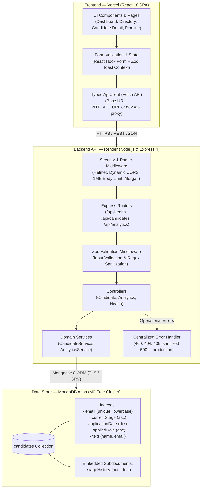

# Mini ATS — Applicant Tracking System

[](https://www.typescriptlang.org/)
[](https://react.dev/)
[](https://nodejs.org/)
[](https://expressjs.com/)
[](https://cloud.mongodb.com/)
[](https://vitest.dev/)
[](https://opensource.org/licenses/MIT)

A lightweight, full-stack **Applicant Tracking System (ATS)** built for recruitment workflows. It enables recruiters to register candidates, track hiring stages, search and filter candidate records, and monitor recruitment analytics derived directly from database aggregation queries.

---

## Table of Contents

1. [Live Application & Links](#1-live-application--links)
2. [Key Features](#2-key-features)
3. [Architecture Overview](#3-architecture-overview)
4. [Technology Stack](#4-technology-stack)
5. [Project Structure](#5-project-structure)
6. [Local Setup & Installation](#6-local-setup--installation)
7. [Available Scripts](#7-available-scripts)
8. [REST API Overview](#8-rest-api-overview)
9. [Testing & Quality Checks](#9-testing--quality-checks)
10. [Security Considerations](#10-security-considerations)
11. [Known Limitations](#11-known-limitations)
12. [License & Assessment Context](#12-license--assessment-context)

---

## 1. Live Application & Links

| Resource                             | URL                                                                                            |
| ------------------------------------ | ---------------------------------------------------------------------------------------------- |
| **Live Web Application (Vercel)**    | [https://mini-ats-alpha.vercel.app](https://mini-ats-alpha.vercel.app)                         |
| **Backend Health Endpoint (Render)** | [https://mini-ats-60bk.onrender.com/api/health](https://mini-ats-60bk.onrender.com/api/health) |
| **GitHub Repository**                | [https://github.com/Guptsonu22/MINI-ATS](https://github.com/Guptsonu22/MINI-ATS)               |
                                         |

---

## 2. Key Features

### Candidate Management

- **Candidate Registration**: Add candidates with validated fields including full name, normalized email, phone, applied role, years of experience, skills tags, source, resume URL, and notes.
- **Duplicate Email Prevention**: Checks for existing candidate emails and rejects duplicates with HTTP `409 Conflict`.
- **Candidate Profiles**: View complete candidate details, skill tags, contact information, and audit notes.
- **Record Editing**: Update candidate information with server-side validation on modified fields.
- **Two-Step Deletion**: Two-step interactive confirmation dialog (`ConfirmDialog`) before removing records.

### Hiring Pipeline & Audit History

- **Canonical Stages**: Strictly enforces six pipeline stages across client and server:
  - `Applied` — Initial application received.
  - `Screening` — Recruiter phone or resume review.
  - `Interview` — Technical or behavioral interview rounds.
  - `Offer` — Formal offer extended.
  - `Hired` — Offer accepted (terminal positive outcome).
  - `Rejected` — Candidate declined or rejected (terminal negative outcome).
- **Stage History Audit Trail**: Appends an immutable log (`stageHistory`) to the candidate document recording previous stage, new stage, timestamp, and optional recruiter notes.
- **Pipeline Kanban Board**: Column-based view grouping candidates by stage with quick stage transition controls.

### Search, Filtering, Sorting & Pagination

- **Text Search**: Case-insensitive search across candidate name and email with special-character escaping to prevent Regular Expression Denial of Service (ReDoS).
- **Multi-Criteria Filtering**: Filter candidate records by current stage, applied role substring, and experience boundaries.
- **Sorting**: Sort by application date, candidate name, or years of experience in ascending or descending order.
- **Server-Side Pagination**: Configurable page index and limits (up to 100 per page) with total count metadata.

### Dashboard Analytics

- **Live Metrics**: Metric cards showing **Total Candidates**, **In Pipeline (Active)**, **Offers & Hired**, and **Rejected** calculated directly via MongoDB aggregation.
- **Consistent Active Definition**: Active candidates strictly include `Applied`, `Screening`, `Interview`, and `Offer`. Terminal outcomes (`Hired` and `Rejected`) are excluded from active counts:
  $$\text{Active Candidates} = \text{Total Candidates} - (\text{Hired} + \text{Rejected})$$
- **Stage Distribution Chart**: Recharts bar chart displaying candidate counts across all six canonical stages.
- **Recent Applicants**: Table of recently submitted candidates with direct profile links.

### Validation, Error Handling & Accessibility

- **Input Validation**: Client and server validation using shared Zod schema rules.
- **Network Resilience**: Loading skeletons during in-flight queries and error banners with manual retry buttons.
- **Form UX**: Double-submit lock on action buttons to prevent duplicate requests.
- **Accessibility (a11y)**: Accessible ARIA labels (`aria-invalid`, `role="alert"`), semantic structure, and `Escape` key handling to dismiss modals.

---

## 3. Architecture Overview



### Request Lifecycle

1. **User Action & Client Validation**: When a user registers a candidate or updates a stage, inputs are validated client-side with React Hook Form and Zod schemas.
2. **HTTP Transmission**: `ApiClient` sends an HTTPS request to the configured `VITE_API_URL` endpoint.
3. **Middleware & Security**: Express invokes Helmet security headers, validates the `Origin` header against `CLIENT_ORIGIN` via CORS, enforces a 1MB payload size limit, and logs requests with Morgan.
4. **Server Validation**: Dedicated Zod validation middleware validates route parameters, query strings, and request bodies before execution reaches controllers.
5. **Business Logic & Persistence**: The controller delegates to `CandidateService` or `AnalyticsService`, which execute parameterized Mongoose operations or aggregation pipelines against MongoDB Atlas.
6. **Standardized Response**: The server returns a consistent JSON envelope `{ success: true, data, pagination? }`. Operational failures yield structured error codes (`400`, `404`, `409`), while unexpected `500` errors are masked in production.

---

## 4. Technology Stack

| Layer                   | Technology             | Purpose                                                    |
| ----------------------- | ---------------------- | ---------------------------------------------------------- |
| **Frontend Framework**  | React 18               | Component-based reactive user interface                    |
| **Language**            | TypeScript 5           | Static typing across both client and server workspaces     |
| **Build Tool**          | Vite 5                 | Fast development server and production client bundler      |
| **Styling**             | Tailwind CSS 3         | Utility-first responsive UI styling                        |
| **Routing**             | React Router DOM 6     | Client-side routing with nested layouts and route rewrites |
| **Forms & Validation**  | React Hook Form & Zod  | Form state management and schema-based validation          |
| **Data Visualization**  | Recharts 2             | SVG-based responsive bar charts for stage metrics          |
| **Icons**               | Lucide React           | Scalable UI iconography                                    |
| **Backend Runtime**     | Node.js (20.x LTS)     | Server execution environment                               |
| **Web Framework**       | Express 4              | REST routing, middleware, and request handling             |
| **Database**            | MongoDB Atlas (M0)     | Cloud document database with TLS encryption                |
| **ODM**                 | Mongoose 8             | Schema modeling, hooks, and aggregation queries            |
| **Security Middleware** | Helmet & CORS          | Security headers and cross-origin access control           |
| **Testing**             | Vitest & Supertest     | Unit, component, and REST integration test suites          |
| **Component Testing**   | @testing-library/react | Accessible DOM testing for React components                |

---

## 5. Project Structure

```
MINI ATS/
├── client/                               # React + Vite frontend workspace
│   ├── src/
│   │   ├── api/                          # Typed ApiClient and candidate API service
│   │   ├── components/                   # UI primitives (Button, Input, Select, Badge, ConfirmDialog)
│   │   ├── context/                      # Toast notification context
│   │   ├── features/candidates/          # Forms, filters, tables, and pipeline cards
│   │   ├── pages/                        # DashboardPage, CandidatesPage, CandidateDetailPage, PipelinePage
│   │   └── types/                        # Shared TypeScript models and response types
│   ├── tests/                            # Vitest + Testing Library test suites (30 tests)
│   ├── .env.example                      # Client environment variable template
│   ├── vercel.json                       # Vercel SPA route rewrite rules
│   └── vite.config.ts                    # Vite config with local /api dev proxy
│
├── server/                               # Node.js + Express backend workspace
│   ├── src/
│   │   ├── config/                       # database.ts (Mongoose) and environment.ts (Zod)
│   │   ├── constants/                    # Canonical stages enum
│   │   ├── controllers/                  # Route handlers (candidate, analytics, health)
│   │   ├── middleware/                   # errorHandler, notFoundHandler, validate middleware
│   │   ├── models/                       # candidate.model.ts (Mongoose schema and indexes)
│   │   ├── routes/                       # Express router definitions
│   │   ├── schemas/                      # Zod validation schemas for requests and queries
│   │   ├── services/                     # Business logic and MongoDB aggregation queries
│   │   └── utils/                        # seed.ts (Mock data generator with production guards)
│   ├── tests/                            # Vitest + Supertest API test suites (36 tests)
│   ├── .env.example                      # Server environment variable template
│   └── API_DOCUMENTATION.md              # Detailed REST API schema documentation
│
├── render.yaml                           # Render web service deployment configuration
├── eslint.config.js                      # Flat ESLint configuration
├── package.json                          # Monorepo root with npm workspaces
└── README.md                             # This documentation
```

---

## 6. Local Setup & Installation

### Prerequisites

- **Node.js**: `v20.x` or higher (LTS recommended)
- **npm**: `v10.x` or higher
- **MongoDB**: Local MongoDB instance (`mongodb://127.0.0.1:27017`) or MongoDB Atlas connection string

### 1. Clone the Repository

```bash
git clone https://github.com/Guptsonu22/MINI-ATS.git
cd MINI-ATS
```

### 2. Install Workspace Dependencies

Install dependencies across all workspaces from the project root:

```bash
npm install
```

### 3. Configure Environment Files

Copy the example environment templates:

```powershell
# Windows PowerShell
Copy-Item server/.env.example server/.env
Copy-Item client/.env.example client/.env
```

```bash
# Bash / macOS / Linux
cp server/.env.example server/.env
cp client/.env.example client/.env
```

Edit `server/.env` with your database URI and preferred settings:

```env
PORT=5000
NODE_ENV=development
MONGODB_URI=mongodb://127.0.0.1:27017/mini_ats
MONGODB_TEST_URI=mongodb://127.0.0.1:27017/mini_ats_test_runner
CLIENT_ORIGIN=http://localhost:5173
```

_(In `client/.env`, `VITE_API_URL` can remain empty for local development because Vite's proxy automatically forwards `/api` requests to `http://localhost:5000`)._

### 4. Seed Development Data (Optional)

To populate 12 fictional candidates across all six stages for testing:

```bash
npm run seed
```

> ⚠️ **Warning**: Do not execute seed commands against production databases. The seed utility includes an automated guard that prevents execution when `NODE_ENV=production`.

### 5. Start the Application

Run both backend and frontend concurrently:

```bash
npm run dev
```

- **Frontend Client**: [http://localhost:5173](http://localhost:5173)
- **Backend API**: [http://localhost:5000](http://localhost:5000)
- **Health Check**: [http://localhost:5000/api/health](http://localhost:5000/api/health)

---

## 7. Available Scripts

The root `package.json` coordinates all tasks across workspaces:

```bash
# Development
npm run dev               # Start both server and client concurrently
npm run dev:server        # Start server with tsx hot-reloading (port 5000)
npm run dev:client        # Start client with Vite (port 5173)

# Build & Quality
npm run build             # Build both server (tsc) and client (Vite)
npm run build:server      # Build server to server/dist/
npm run build:client      # Build client to client/dist/
npm run typecheck         # Run TypeScript checks across both workspaces
npm run lint              # Run ESLint on all TypeScript and TSX files
npm run format            # Format files with Prettier
npm run format:check      # Check formatting with Prettier

# Testing & Utilities
npm run test              # Execute full test suite (66 tests)
npm run test:server       # Run backend API test suites (36 tests)
npm run test:client       # Run frontend component test suites (30 tests)
npm run seed              # Seed database with sample candidate records
```

---

## 8. REST API Overview

All routes are served under the `/api` prefix. Responses return a standard JSON envelope:

```json
{
  "success": true,
  "data": { ... },
  "pagination": { ... }
}
```

### Verified Endpoints

| Method   | Endpoint                    | Description                                                              |        Status Codes        |
| -------- | --------------------------- | ------------------------------------------------------------------------ | :------------------------: |
| `GET`    | `/api/health`               | Health check and database connection status                              |        `200`, `503`        |
| `GET`    | `/api/candidates`           | List candidates with pagination, search, stage/role filters, and sorting |        `200`, `400`        |
| `POST`   | `/api/candidates`           | Register a new candidate (validates schema, prevents duplicate emails)   |    `201`, `400`, `409`     |
| `GET`    | `/api/candidates/:id`       | Fetch candidate profile with complete stage history audit trail          |    `200`, `400`, `404`     |
| `PATCH`  | `/api/candidates/:id`       | Update candidate fields (name, phone, role, experience, notes, etc.)     | `200`, `400`, `404`, `409` |
| `PATCH`  | `/api/candidates/:id/stage` | Transition candidate stage and append an audit trail entry               |    `200`, `400`, `404`     |
| `DELETE` | `/api/candidates/:id`       | Permanently remove a candidate record                                    |    `200`, `400`, `404`     |
| `GET`    | `/api/analytics`            | Retrieve metrics summary, stage distributions, and recent applicants     |           `200`            |

For detailed request/response schemas, sample payloads, and query parameter documentation, see [`server/API_DOCUMENTATION.md`](server/API_DOCUMENTATION.md).

---

## 9. Testing & Quality Checks

The project includes **66 automated tests** across 8 test suites verifying backend endpoints, database queries, frontend workflows, and accessibility.

```bash
npm run test
```

### Test Suite Summary

| Scope      | Test File                                                                                   | Tests | Validated Behavior                                                                                           |
| ---------- | ------------------------------------------------------------------------------------------- | :---: | ------------------------------------------------------------------------------------------------------------ |
| **Server** | [`candidates.test.ts`](server/tests/candidates.test.ts)                                     |  17   | Full candidate CRUD, pagination limits, text search, stage filters, duplicate email rejection (`409`).       |
| **Server** | [`reliability.test.ts`](server/tests/reliability.test.ts)                                   |  14   | Malformed ObjectIDs (`400`), missing records (`404`), all six stage transitions, ReDoS injection resistance. |
| **Server** | [`analytics.test.ts`](server/tests/analytics.test.ts)                                       |   3   | Metric calculations, active vs terminal counts, empty database handling.                                     |
| **Server** | [`health.test.ts`](server/tests/health.test.ts)                                             |   2   | API status response and MongoDB connection health reporting.                                                 |
| **Client** | [`CandidateWorkflows.test.tsx`](client/tests/CandidateWorkflows.test.tsx)                   |  12   | Candidate creation flow, edit dialogs, stage updates, deletion confirmation, conflict alerts.                |
| **Client** | [`AnalyticsDashboard.test.tsx`](client/tests/AnalyticsDashboard.test.tsx)                   |   6   | Metric card rendering, stage distribution chart, recent candidates table, empty state.                       |
| **Client** | [`AccessibilityAndReliability.test.tsx`](client/tests/AccessibilityAndReliability.test.tsx) |   8   | ARIA attributes, `Escape` key dismissals, double-submit protection, 404 recovery.                            |
| **Client** | [`App.test.tsx`](client/tests/App.test.tsx)                                                 |   4   | Navigation menu, responsive mobile drawer, route switching.                                                  |

### Quality Commands

```bash
npm run typecheck    # Strict TypeScript checks across server and client (0 errors)
npm run lint         # ESLint check on entire codebase (0 errors, 0 warnings)
npm run build        # Production builds for server (tsc) and client (Vite)
```

---

## 10. Security Considerations

- **Secret Isolation**: All credentials (`MONGODB_URI`) are stored in untracked `.env` files or hosting dashboards. The root `.gitignore` excludes `.env*` files.
- **Server-Side Validation**: Every request is validated by Zod schemas before database execution. Client-side validation is supplemented by server enforcement.
- **HTTP Security Headers**: Express uses `helmet` to set defensive HTTP headers (e.g. XSS protection, MIME sniffing prevention, frameguard).
- **Request Size Limits**: Express body parsers enforce a strict `1mb` payload size limit (`express.json({ limit: '1mb' })`) to prevent memory exhaustion attacks.
- **Error Masking**: In production (`NODE_ENV=production`), unhandled `500` server errors return a generic message, and stack traces are suppressed.
- **ReDoS Prevention**: Search inputs in candidate queries are escaped using `replace(/[.*+?^${}()|[\]\\]/g, '\\$&')` prior to constructing regex filters.
- **Production Seed Guard**: The `seed.ts` script checks `NODE_ENV` and halts execution if running in production unless `ALLOW_SEED_IN_PRODUCTION=true` is explicitly set.

---

## 11. Known Limitations

- **Render Free-Tier Cold Starts**: Free Render web services spin down after 15 minutes of inactivity. The initial request following a sleep period may take 25–40 seconds to complete. Subsequent requests respond in milliseconds.
- **Single-Tenant / Unauthenticated**: The application is designed as an intern assessment demonstration and does not implement multi-tenant tenancy, role-based access control, or user authentication.
- **Resume Storage**: The `resumeUrl` field accepts external document links; direct file-binary upload to cloud object storage (e.g. AWS S3) is not implemented.

---

## 12. License & Assessment Context

This project is licensed under the [MIT License](https://opensource.org/licenses/MIT).

Developed as part of the **EarlyJobs Full Stack Developer Intern** technical assessment.
